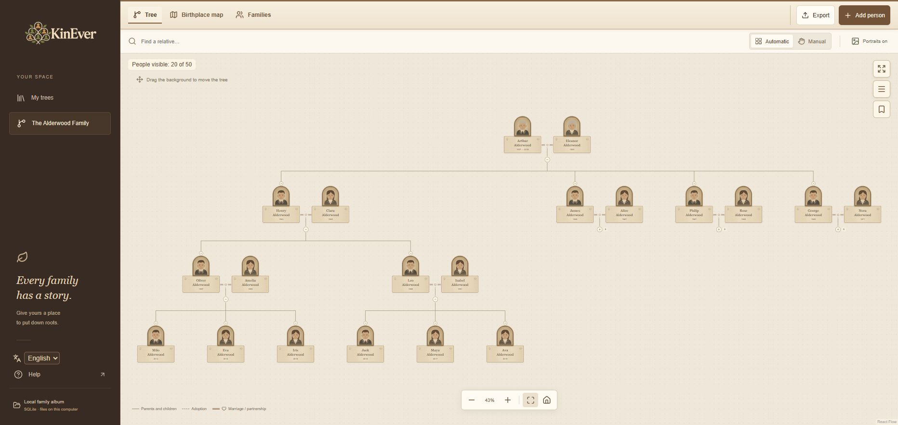
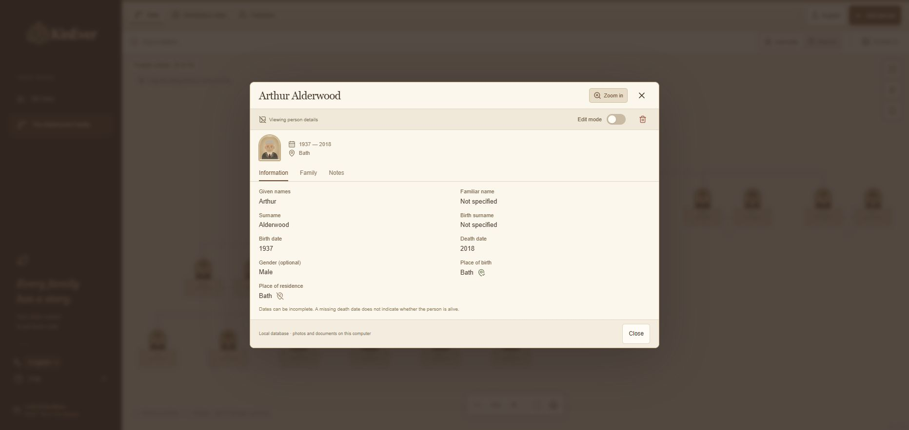
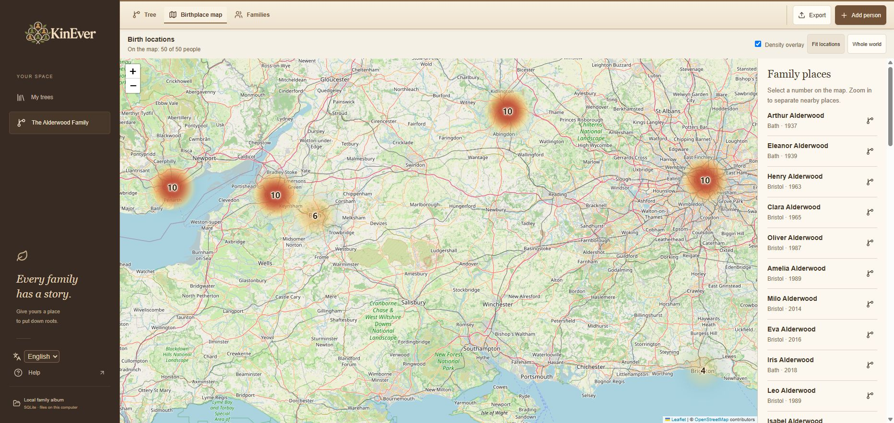
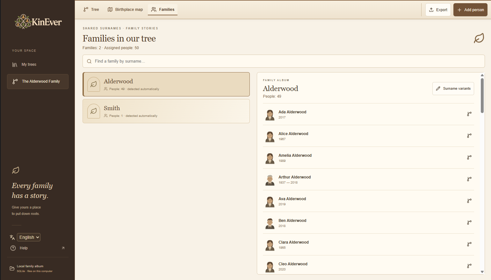
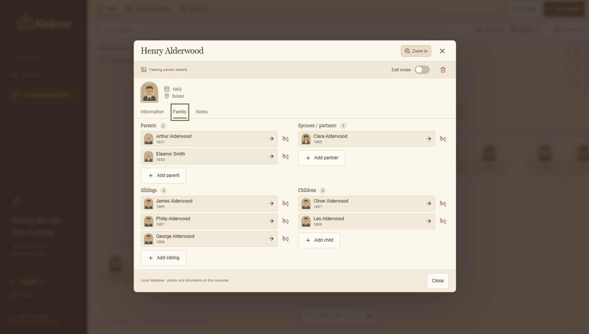
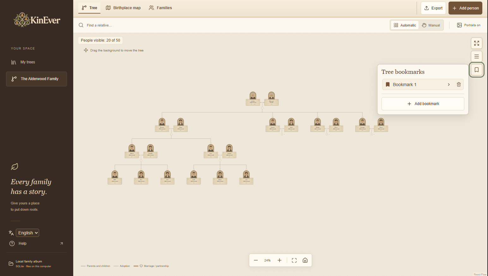
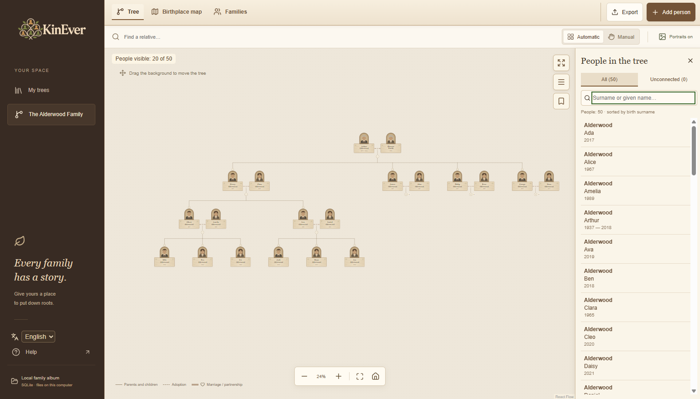

# KinEver


KinEver is a local genealogy app for building family trees, storing family photos and documents, and exchanging records with other genealogy tools. It runs in English and Polish. Your album is stored on your computer.

## Try an example family

[Download the Alderwood family GEDCOM](examples/alderwood-family.ged) to explore **50 fictional people across four generations**, with 85 family relationships and mapped birthplaces. From **My trees**, choose **Import a family** and select the file. KinEver opens it as a separate album.

### Explore the album



| Person profile | Birthplace map |
| --- | --- |
|  |  |

| Surname catalog | Family relationships |
| --- | --- |
|  |  |

| Tree bookmarks | People directory |
| --- | --- |
|  |  |

## Download and run on Windows

1. Open the **Releases** tab and download `KinEver-1.0.0-win-x64.zip`.
2. Extract the entire archive to a folder of your choice.
3. Open `KinEver/KinEver.exe`. Keep the `_internal` folder next to the executable.

The desktop package includes Python and uses Microsoft Edge WebView2 Runtime. A new installation starts with an empty library. If you previously used the Korzenie or KinEver alpha, close it before launching this release. KinEver reads the same local album automatically.

## Use your album

- Expand branches on an interactive family tree, switch between partners, and save tree layouts as colored bookmarks.
- Open a profile to edit names, dates, places, portraits, notes and attachments. Right-click a card to add relatives. In the **Family** tab, use the broken-link icon to detach a relationship.
- Use the birthplace map and surname catalog to explore the album. The map and place search use OpenStreetMap services and require internet access. Place searches send the place name to the service.
- Import GEDCOM and GEDZIP from the library. Export GEDCOM for exchange or use a supported ZIP format to include media. Keep the original GEDCOM for source information and fields that KinEver does not import.

## Data and backups

The Windows desktop app stores `genealogy.sqlite3` and the `media/` directory in `%LOCALAPPDATA%\Korzenie\alpha`. The directory name is retained for compatibility with existing albums. Choose **Local family album → Download a full backup of the database and files** to save both together.

To restore a backup, close the app, keep a copy of the current data directory, and extract the backup into an empty data directory at the same location. The source-based server uses `data/` by default and supports the `GENEALOGY_DATA_DIR` override.

## Run from source

Requires Python 3.12, Node.js 22.12 or newer, and pnpm 11.25.0. From the repository on Windows:

```powershell
python -m venv .venv
./.venv/Scripts/python.exe -m pip install -r backend/requirements-dev.txt
pnpm install --frozen-lockfile
pnpm build
powershell.exe -NoProfile -ExecutionPolicy Bypass -File ./Start-App.ps1
```

Open http://127.0.0.1:8000/. For frontend development, also run `pnpm dev` and open http://127.0.0.1:5173/. Vite proxies local API requests to the Python server.

## Test and build a Windows release

```powershell
pnpm test
./.venv/Scripts/python.exe -m pytest backend/tests
./.venv/Scripts/python.exe -m pip install -r backend/requirements-desktop.txt
powershell.exe -NoProfile -ExecutionPolicy Bypass -File ./Build-Release.ps1
```

The build writes the Windows app and ZIP under `output/release/`. Upload the ZIP as a release asset. Keep databases, uploads, exported trees, and build output out of the source repository.
